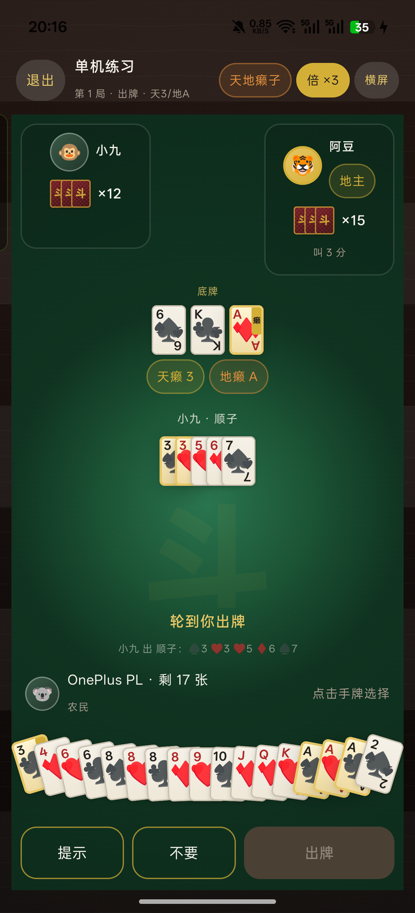
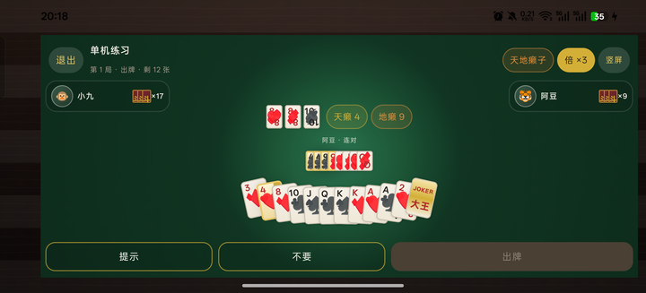

# LAN Dou Dizhu · Kotlin Multiplatform

[](https://github.com/Zerlinw/doudizhu-lan-party/actions/workflows/build.yml)

[中文](README.md) · [English](README.en.md)

[](LICENSE)

> Zero server, peer-to-peer, three phones, one table. The host device is the authoritative Host; every other device only sends intents and renders snapshots.
>
> Author: **Zerlin** · Repository: [github.com/Zerlinw/doudizhu-lan-party](https://github.com/Zerlinw/doudizhu-lan-party) · Android first, with the architecture prepared for Desktop / iOS.

---

## 1. What is this?

A complete LAN Dou Dizhu (Fight the Landlord) project:

- **Pure Kotlin rules core**: 54-card deck, 16 hand types (including soft bomb and pure-laizi bomb), bidding, bombs/rocket, Spring/Anti-Spring, settlement.
- **Tian-Di Laizi mode**: 8 wildcards (4 Tian Laizi + 4 Di Laizi), soft/hard/pure-laizi bombs, bombs ordered by size and type.
- **Host-authoritative TCP**: the host runs the only reducer and broadcasts full snapshots; clients do not re-run rules.
- **NSD discovery**: `_doudizhu._tcp` finds rooms automatically; manual `IP:port` is the fallback.
- **Reconnect**: 5s heartbeat / 15s timeout, exponential backoff, `SYNC_REQ(lastKnownSeq)` full-snapshot recovery, AI takeover for offline seats.
- **Two AIs**: sub-millisecond heuristic (default) and 800ms budgeted Monte Carlo (optional hard mode).
- **Compose dark wooden UI**: fan-shaped hand, laizi highlights, deal animations, bomb flash, landlord bottom-card reveal, settlement sheet.
- **Portrait + landscape**: compact landscape table; orientation can be switched from the home screen or the table.
- **CI**: GitHub Actions runs unit tests, builds the debug APK, and compiles Desktop.

## 2. Screenshots

Taken on a real OnePlus PLC110 / Android 16 device:

| Home (mode picker) | Classic table | Tian-Di Laizi · portrait | Tian-Di Laizi · landscape |
|---|---|---|---|
|  |  |  |  |

See [docs/verification.md](docs/verification.md) for the full build, signing, and device verification log (currently in Chinese).

## 3. Implemented / not implemented

| Milestone | Status | Notes |
|---|---|---|
| M1 Project skeleton | ✅ | Version catalog, multi-module, CI, wooden home screen |
| M2 Single-device rules | ✅ | 13 classic + 3 laizi hand types, reducer, 3 AI practice mode, 71 tests |
| M3 LAN multiplayer | ✅ | NSD + TCP + heartbeat + reconnect snapshot + lobby + manual IP |
| M4 Motion polish | ✅ | Laizi highlight, deal/play/bomb/bottom-card animation, haptics, portrait/landscape |
| M5 Cross-platform finish | ◐ | Desktop compiles (preview UI); iOS target is configured on macOS, `iosMain` is a compile stub |

Intentionally out of scope: voice/audio assets (haptics instead), room passwords, spectating, persistent match history, real-device iOS networking.

## 4. Quick start

### 4.1 Environment

- JDK 17
- Android SDK Platform 35 + Build-Tools 35.0.0
- Android 7.0 (API 24) or newer

> If Gradle downloads are slow in mainland China, replace `distributionUrl` in
> `gradle/wrapper/gradle-wrapper.properties` with
> `https://mirrors.cloud.tencent.com/gradle/gradle-8.9-bin.zip`.

```bash
# The repository ships the Gradle Wrapper
./gradlew :androidApp:assembleRelease
# Output: androidApp/build/outputs/apk/release/androidApp-release.apk
adb install -r androidApp/build/outputs/apk/release/androidApp-release.apk
```

Windows:

```powershell
.\gradlew.bat :androidApp:assembleRelease
adb install -r androidApp\build\outputs\apk\release\androidApp-release.apk
```

### 4.2 Three phones, one game

1. Connect all three phones to the **same Wi-Fi**.
2. On the host, choose **Classic** or **Tian-Di Laizi** on the home screen, then tap **Create room**. The lobby shows `IP:port` (default `9527`; occupied ports are tried in sequence).
3. On the other two phones, tap **Join room** and pick the room from the NSD list. If discovery fails, use **Manual connect** and enter the `IP:port` shown on the host.
4. When all three seats are filled, the host taps **Start game**.
5. Single-device practice: choose a mode on the home screen → **Practice (3 AI players)**. Two heuristic AIs join the table.
6. Landscape: tap **Landscape / Portrait** at the top-right of the home screen or table; physically rotating the phone also enters the compact landscape layout.

> If the host leaves the app, the match is interrupted. Android power saving may also kill NSD; manual IP always remains available.

## 5. Project layout

```
.
├─ androidApp/                 # Android Compose entry (UI consumes StateFlow only)
├─ desktopApp/                 # Compose Desktop M5 preview
├─ shared/                     # KMP: rules / AI / network / discovery / session
│  └─ src/
│     ├─ commonMain/kotlin/com/ddz/shared/
│     │  ├─ game/core/         # Cards / HandParser / GameState / Reducer / Engine
│     │  ├─ ai/                # HandAnalyzer / HandFinder / HeuristicAi / MctsAi
│     │  ├─ net/               # protocol, length-prefixed frames, TCP expect/actual
│     │  ├─ discovery/         # NSD expect/actual + RoomInfo
│     │  └─ session/           # Host / Client / Local + AI takeover
│     ├─ androidMain/          # NsdManager + java.net actuals
│     ├─ jvmMain/              # UDP broadcast discovery + java.net actuals (Desktop)
│     ├─ iosMain/              # compile stub (iOS target only enabled on macOS hosts)
│     └─ commonTest/           # 71 tests: hand types/laizi/comparison/reducer/AI/protocol
├─ docs/rules.md               # rules, one-to-one with the implementation
├─ docs/protocol.md            # frame format, message table, reconnect semantics
├─ keystore/                   # local signing material (.gitignore)
└─ .github/workflows/build.yml # CI
```

### Module contracts

| Module | Responsibility | Forbidden |
|---|---|---|
| `game-core` | hand types, validation, bidding, multipliers, settlement, reducer | platform / network / AI dependencies |
| `ai-engine` | hand decomposition, candidate generation, heuristic, MCTS | mutable global state |
| `network` | frame codec, TCP, heartbeat, snapshot recovery | game rules |
| `discovery` | NSD / UDP broadcast | game messages |
| `androidApp` | Compose, animation, navigation | recomputing rules in UI |

## 6. State synchronization

```
Client A ── JOIN ─────▶ Host (single reducer)
Client B ── PLAY ─────▶ Host validate → reduce → seq+1
                        │
                        ├─ ROOM_STATE (public seating info)
                        └─ SNAPSHOT(redactedFor(seat), seq)
```

- `GameState.seq` increments on every accepted action; clients only accept snapshots with `seq > lastSeq`.
- Snapshots are **redacted per seat**: only your own hand is visible; other seats expose `cardCount` only. Bottom cards are hidden before the landlord is decided.
- Snapshots carry `mode` and `laizi` (Tian/Di ranks), so clients never need to rerun the random selection.
- Reconnect: `JOIN(same name)` reclaims the old seat → `SYNC_REQ(lastSeq)`. If the host is behind, it sends a full snapshot; otherwise `ACK`.
- If no heartbeat arrives for 15s, the host marks the seat offline → `SetOnline(false)` → AI takeover; control is returned automatically on reconnect.
- Full snapshots stay below 4KB (asserted in tests); there is no incremental replay.

See [docs/protocol.md](docs/protocol.md) for details.

## 7. Rules

The implementation follows common Dou Dizhu rules; intentional differences are covered by tests:

- Bidding: 1/2/3 points, one chance per player, 3 points immediately wins the bid; if everyone passes, the deck is redealt automatically.
- Straight ≥5 cards, consecutive pairs ≥3 pairs, airplane ≥2 consecutive triples; 2 and jokers cannot appear in sequences.
- Four-with-two / four-with-two-pairs: the two pairs must have different ranks.
- Classic mode: every bomb/rocket ×2; joker in the bottom cards ×2; Spring/Anti-Spring ×2.
- Tian-Di Laizi: 8 wildcards (4 Tian + 4 Di), soft bomb < hard bomb < pure-laizi bomb, bombs compare by size first; 4-card soft ×2, 4-card hard/pure ×4, 5+ bombs/rocket ×6.
- The landlord scores double, each farmer single; the three deltas sum to zero.

See [docs/rules.md](docs/rules.md) for details and examples.

## 8. Tests

```bash
./gradlew :shared:jvmTest
```

Currently **71 tests, all green**, covering:

- positive/negative cases and boundaries for all 16 hand types (2 cannot enter a straight; four-with-two-pairs rejects equal-rank pairs);
- Tian-Di Laizi: soft/hard/pure-laizi bomb detection, 4→12 bomb ladder, laizi filling straights/consecutive pairs/airplanes, laizi cannot act as a joker;
- the `canBeat` matrix (bombs/rocket/length/wings);
- dealing 17×3+3, bidding, all-pass redeal, play/pass, two passes and a fresh lead;
- bomb multipliers, Spring, Anti-Spring, zero-sum settlement, autopilot fallback;
- AIs do not break bombs, yield to teammates, finish in one hand; classic/laizi self-play all converge;
- 14 protocol message round-trips, unknown types/payload mismatch/oversized frames/negative seq rejection, snapshot redaction, laizi state serialization;
- **JVM loopback integration**: real TCP port + real Host/Client state machines, two clients joining, dealing, and snapshot redaction.

## 9. Signing

Private keys are not committed. Generate one locally:

```bash
keytool -genkeypair -v -keystore keystore/ddz-release.jks -alias ddz \
  -keyalg RSA -keysize 2048 -validity 10000 \
  -dname "CN=Zerlin, OU=LanParty, O=Zerlin, L=Shanghai, ST=Shanghai, C=CN"
```

`keystore.properties` (already in `.gitignore`):

```properties
storeFile=keystore/ddz-release.jks
storePassword=******
keyAlias=ddz
keyPassword=******
```

Without this file, `release` falls back to the debug signature; CI can still produce an installable APK.

## 10. CI

`.github/workflows/build.yml`:

- `build`: JDK 17 → `:shared:jvmTest` → `:androidApp:assembleDebug` → upload APK artifact;
- `desktop`: `:desktopApp:compileKotlin`;
- `ios` (macOS): `:shared:compileKotlinIosArm64` compile check only.

## 11. Known limitations

1. iOS currently only guarantees compilation; the TCP/NSD actuals are stubs and need NSNetService / NWConnection for M6.
2. Desktop is only "compiles + shares single-device logic"; its UI is still a minimal preview.
3. The host is a single point: if the host leaves, the room ends; there is no host migration.
4. No bundled audio assets; bombs use system haptic feedback.
5. NSD may be rate-limited on some ROMs; manual IP is the first-class fallback.
6. The landscape layout is compact; extremely short screens (<340dp high) may compress table information. The landscape button is at the top-right of the home screen/table.

## 12. License

This project is released under the **MIT License**. Copyright (c) 2026 **Zerlin**.

- Full license text: [LICENSE](LICENSE)
- You may use, copy, modify, merge, publish, distribute, sublicense, and/or sell copies of the software, provided the copyright notice and this permission notice are included in all copies or substantial portions.
- The software is provided **"AS IS"**, without warranty of any kind, express or implied. The authors and copyright holders are **not liable** for any claim, damages, or other liability arising from the software or its use.
- Third-party dependencies (Kotlin, Compose Multiplatform, AndroidX, kotlinx.coroutines, kotlinx.serialization, etc.) remain under their respective licenses. See [THIRD_PARTY_NOTICES.md](THIRD_PARTY_NOTICES.md).
- This project is an independent implementation. It does not include art, audio, trademarks, or decompiled code from Tencent's "Happy Dou Dizhu" or any other commercial game. Third-party names and trademarks belong to their owners.

> The warranty disclaimer and limitation of liability are intended to reduce legal risk, but no license can guarantee immunity from third-party claims. This is not legal advice; consult a lawyer before commercial distribution.

---

**Zerlin's LAN Party v1.1.0** · Kotlin 2.1 · Compose Multiplatform 1.7 · AGP 8.7
