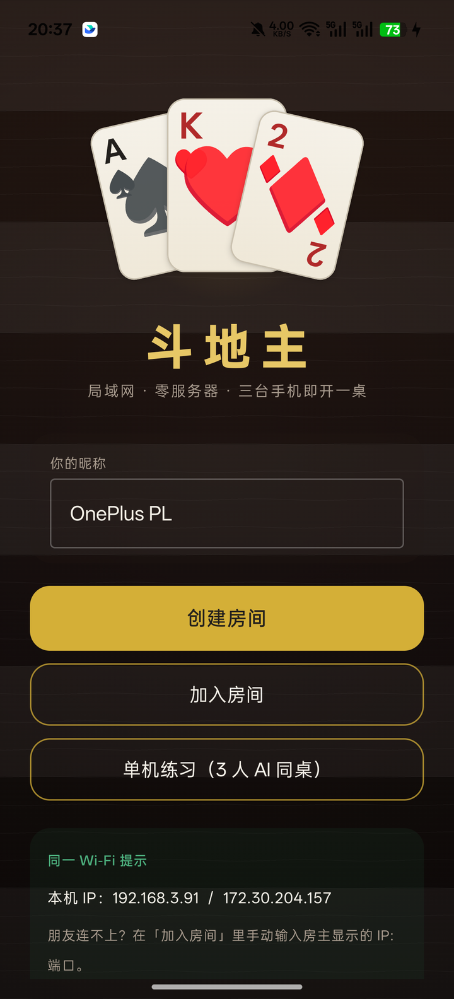
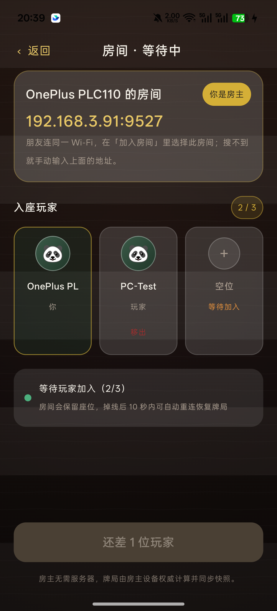
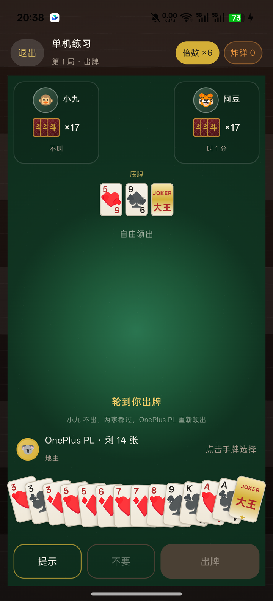

# 局域网斗地主 · Kotlin Multiplatform

> 零服务器、点对点、三台手机开一桌。房主设备是权威 Host，其余设备只发送意图、渲染快照。
>
> 作者：**Zerlin** · 首期 Android，架构预留 Desktop / iOS。

---

## 1. 这是什么

一个完整的局域网斗地主工程：

- **纯 Kotlin 规则内核**：54 张牌、13 种牌型、叫分、炸弹/王炸、春天/反春天、结算。
- **Host 权威 + TCP 长连接**：房主执行唯一 reducer，广播全量快照；客户端零规则计算。
- **NSD 服务发现**：`_doudizhu._tcp` 自动找房，手动 `IP:端口` 兜底。
- **断线重连**：心跳 5s / 15s 超时、指数退避重连、`SYNC_REQ(lastKnownSeq)` 全量快照恢复、掉线 AI 托管。
- **两种 AI**：<1ms 启发式（默认）+ 800ms 硬预算蒙特卡洛（高难度可选）。
- **Compose 深色木质 UI**：扇形手牌、发牌动画、炸弹闪光、地主底牌翻开、结算面板、点击音效由系统触感替代。
- **CI**：GitHub Actions 跑单测 + Debug APK + Desktop 编译。

## 2. 真机效果

在 OnePlus PLC110 / Android 16 真机实拍（PC 客户端通过 TCP 加入手机房间）：

| 首页 | 房间大厅 | 牌桌 |
|---|---|---|
|  |  |  |

构建、签名、真机验证的完整记录见 [docs/verification.md](docs/verification.md)。

## 3. 已实现 / 未实现

| 里程碑 | 状态 | 说明 |
|---|---|---|
| M1 工程骨架 | ✅ | 版本目录、多模块、CI、木质首页 |
| M2 单机核心规则 | ✅ | 13 种牌型、reducer、3 AI 练习模式、61 个测试 |
| M3 局域网联机 | ✅ | NSD + TCP + 心跳 + 重连快照 + 大厅 + 手动 IP |
| M4 动效体验 | ✅ | 发牌/出牌/炸弹/地主底牌动画、震动、托管提示 |
| M5 跨平台收尾 | ◐ | Desktop 已编译（预览 UI）；iOS 目标仅在 macOS 配置，`iosMain` 为编译桩 |

未做（有意留白）：语音/音效资源（用触感替代）、房间密码、观战、战绩持久化、iOS 真机网络。

## 4. 快速开始
### 4.1 环境

- JDK 17
- Android SDK Platform 35 + Build-Tools 35.0.0
- 设备 Android 7.0（API 24）及以上

> 国内网络如果 `./gradlew` 卡在下载 Gradle，把
> `gradle/wrapper/gradle-wrapper.properties` 的 `distributionUrl` 换成
> `https://mirrors.cloud.tencent.com/gradle/gradle-8.9-bin.zip` 即可。

```bash
# 本仓库自带 Gradle Wrapper
./gradlew :androidApp:assembleRelease
# 产物：androidApp/build/outputs/apk/release/androidApp-release.apk
adb install -r androidApp/build/outputs/apk/release/androidApp-release.apk
```

Windows：

```powershell
.\gradlew.bat :androidApp:assembleRelease
adb install -r androidApp\build\outputs\apk\release\androidApp-release.apk
```

### 4.2 三台手机开一局

1. 三台手机连**同一个 Wi-Fi**。
2. 房主点「创建房间」，大厅会显示 `IP:端口`（默认 `9527`，被占用会自动顺延）。
3. 另外两台点「加入房间」→ 从 NSD 列表选择房间；搜不到就点「手动连接」，输入房主屏幕上的 `IP:端口`。
4. 三人入座后房主点「开始游戏」。
5. 单机体验：首页「单机练习」，两个启发式 AI 同桌。

> 房主切后台会中断牌局；Android 的省电策略可能杀 NSD，手动 IP 始终可用。

## 5. 工程结构

```
.
├─ androidApp/                 # Android Compose 入口（UI 只消费 StateFlow）
├─ desktopApp/                 # Compose Desktop M5 预览
├─ shared/                     # KMP：规则 / AI / 网络 / 发现 / 会话
│  └─ src/
│     ├─ commonMain/kotlin/com/ddz/shared/
│     │  ├─ game/core/         # Cards / HandParser / GameState / Reducer / Engine
│     │  ├─ ai/                # HandAnalyzer / HandFinder / HeuristicAi / MctsAi
│     │  ├─ net/               # 协议、长度前缀帧、TCP expect/actual
│     │  ├─ discovery/         # NSD expect/actual + RoomInfo
│     │  └─ session/           # Host / Client / Local + 托管
│     ├─ androidMain/          # NsdManager + java.net actual
│     ├─ jvmMain/              # UDP 广播发现 + java.net actual（Desktop）
│     ├─ iosMain/              # 编译桩（macOS 宿主才启用 iOS target）
│     └─ commonTest/           # 60 个测试：牌型/比较/reducer/AI/协议
├─ docs/rules.md               # 规则口径（与实现一一对应）
├─ docs/protocol.md            # 帧格式、消息表、重连语义
├─ keystore/                   # 本地签名材料（.gitignore）
└─ .github/workflows/build.yml # CI
```

### 模块契约

| 模块 | 职责 | 禁止 |
|---|---|---|
| `game-core` | 牌型、校验、叫分、倍数、结算、reducer | 平台 / 网络 / AI 依赖 |
| `ai-engine` | 拆牌、候选生成、启发式、MCTS | 可变全局状态 |
| `network` | 帧编解码、TCP、心跳、快照恢复 | 游戏规则 |
| `discovery` | NSD / UDP 广播 | 游戏消息 |
| `androidApp` | Compose、动画、导航 | 在 UI 重算规则 |

## 6. 状态同步设计

```
Client A ── JOIN ─────▶ Host（唯一 reducer）
Client B ── PLAY ─────▶ Host validate → reduce → seq+1
                        │
                        ├─ ROOM_STATE（公开座位信息）
                        └─ SNAPSHOT(redactedFor(seat), seq)
```

- `GameState.seq` 每接受一个动作 +1；客户端只接受 `seq > lastSeq` 的快照。
- 快照**按座位脱敏**：只有自己的手牌，其他人仅保留 `cardCount`；底牌在叫地主前隐藏。
- 重连：`JOIN(同名)` 抢回原座位 → `SYNC_REQ(lastSeq)`；Host 发现落后就回全量快照，没落后回 `ACK`。
- Host 15s 收不到心跳即判定掉线 → `SetOnline(false)` → AI 托管继续打；重新连上自动交还控制权。
- 全量快照 < 4KB（有测试断言），不做增量回放。

协议细节见 [docs/protocol.md](docs/protocol.md)。

## 7. 规则口径

实现遵循大众斗地主规则，差异处已固化并有测试：

- 叫分：1/2/3 分，三家各一次机会，3 分立即定地主；全不叫自动重新发牌。
- 顺子 ≥5 张、连对 ≥3 对、飞机 ≥2 个连续三张；2 和王不能进入连牌。
- 四带二 / 四带两对：两对必须不同点数。
- 炸弹、王炸各 ×2；底牌含王 ×2；春天 / 反春天各 ×2。
- 地主输赢双倍，农民单倍，三家分数总和为 0。

细节与示例见 [docs/rules.md](docs/rules.md)。

## 8. 测试

```bash
./gradlew :shared:jvmTest
```

当前 **61 个测试全绿**，覆盖：

- 13 种牌型的正例/反例、边界（2 不能进顺子、四带两对同点对子非法）；
- `canBeat` 矩阵（炸弹/王炸/长度/翅膀）；
- 发牌 17×3+3、叫分、全不叫重发、出牌/过牌、两家过牌重新领出；
- 炸弹翻倍、春天、反春天、零和结算、托管兜底；
- AI 不拆炸弹、队友让牌、一手走完、自对弈 5 局全部收敛；
- 协议 14 类消息往返、未知类型/载荷不匹配/超长帧/seq 负值拒绝、快照脱敏；
- **JVM 回环集成测试**：真实 TCP 端口 + 真实 Host/Client 状态机，两台客户端同时入座、发牌、快照脱敏。

## 9. 签名

仓库不提交私钥。本地生成：

```bash
keytool -genkeypair -v -keystore keystore/ddz-release.jks -alias ddz \
  -keyalg RSA -keysize 2048 -validity 10000 \
  -dname "CN=Zerlin, OU=LanParty, O=Zerlin, L=Shanghai, ST=Shanghai, C=CN"
```

`keystore.properties`（已在 `.gitignore`）：

```properties
storeFile=keystore/ddz-release.jks
storePassword=******
keyAlias=ddz
keyPassword=******
```

没有该文件时，`release` 自动退回 debug 签名，CI 仍可产出可安装包。

## 10. CI

`.github/workflows/build.yml`：

- `build`：JDK 17 → `:shared:jvmTest` → `:androidApp:assembleDebug` → 上传 APK artifact；
- `desktop`：`:desktopApp:compileKotlin`；
- `ios`（macOS）：`:shared:compileKotlinIosArm64` 仅编译验证。

## 11. 已知限制

1. iOS 目前只保证编译，TCP/NSD actual 是桩，需 M6 接 NSNetService / NWConnection。
2. Desktop 只做到“可编译 + 单机逻辑复用”，UI 仍是最小预览。
3. 房主是单点：房主退出即解散；没有 host 迁移。
4. 音效未内置资源，炸弹用系统触感反馈。
5. NSD 在部分 ROM 上会被限流，手动 IP 是既定一级兜底。

---

**Zerlin's LAN Party** · Kotlin 2.1 · Compose Multiplatform 1.7 · AGP 8.7
